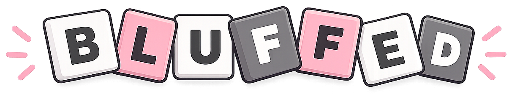

  

<h1 align="center">BLUFFED</h1>

  <strong>A daily puzzle game about separating fact from fiction.</strong>
   
  <em>Six clues. Three lies. One mystery.</em>

  
  
  
  

---

## About

BLUFFED is a free, browser-based puzzle game where players must identify a mystery by separating truthful clues from deliberate lies. Test your knowledge, spot misleading information, and uncover the truth.

🚧 **Currently a work in progress.**

## Tech Stack

- **React** — UI and components
- **JavaScript** — Game logic
- **CSS** — Styling and responsive design
